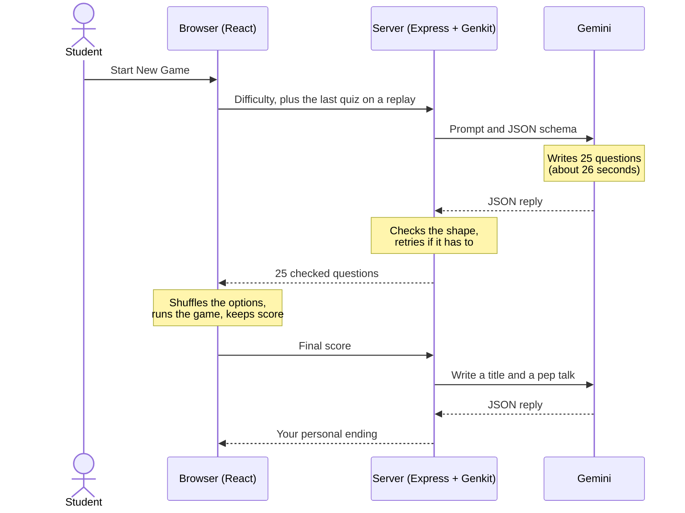

# Brightpoint IT Trivia Challenge

[](https://github.com/benlambm/it-trivia-challenge/actions/workflows/ci.yml)
[](https://github.com/benlambm/it-trivia-challenge/actions/workflows/deploy.yml)
[](https://trivia.benlamb.net)
[](.nvmrc)

**There is no question bank.** When you click Start New Game, generative AI writes a brand new 25-question IT quiz on the spot, at the difficulty you choose. Finish it, and the AI writes you a personal ending too.

**[Play now at trivia.benlamb.net](https://trivia.benlamb.net).** No account, no download, no login.

It's made for students exploring IT careers, and it's built to be read. The codebase is small on purpose, so it doubles as a working example of a real AI app, from the prompt all the way to production.

## What's in a game

- **25 questions, five sectors.** You get five questions each on Networking & Internet, Artificial Intelligence, Program and Database Development, Cybersecurity, and IT Operations and Support.
- **Five difficulty levels.** They run from Much Easier (elementary and middle school) to Much Harder (college and early career). You start at Easier, one notch below Normal.
- **Freedom to bail.** If a quiz doesn't fit, jump to an easier or harder one at any point, or head Home.
- **Fresh questions on replay.** After each quiz you can go easier, stay put, or go harder, and the new quiz steers clear of the one you just played.
- **A personal ending.** Your score earns an AI-written title like "Help Desk Hero" or "Certified Packet Prodigy", a witty review of how you did, and a pitch for taking IT classes at Brightpoint Community College.

A new quiz usually takes about 26 seconds, because the AI really is writing it while you wait. Please don't click Refresh. That starts over from nothing, and the abandoned quiz still gets billed.

## How it works

There are three layers. The browser runs the game, a small Node server guards the API key and checks everything, and Google's Gemini writes the questions.



There's no database and no login. The whole thing is one Node program and a folder of static files. These are the ideas worth borrowing for your own projects.

### The AI has to fill out a form

Asking a model for JSON and hoping for the best won't hold up in a real app. So the rules live in code: exactly 25 questions, each with a category, the question text, exactly four options, and a correct answer.

The rules are written with [Zod](https://zod.dev) in [`api/triviaQuestions.js`](./api/triviaQuestions.js). [Genkit](https://genkit.dev) translates them into JSON Schema and sends that to Gemini along with the prompt. When the reply comes back, [Ajv](https://ajv.js.org) checks it against the same schema, so a reply with 24 questions never reaches a student.

There's one catch: **a schema checks shape, not truth.** The marked answer could still be wrong, because the only thing asking for accuracy is the prompt. Treat these questions the way you'd treat anything else an AI tells you.

### The memory lives in your browser

The server remembers nothing between games. To avoid repeats, your browser sends the last quiz along with the next request, and the prompt tells Gemini not to repeat or closely paraphrase any of it. That memory only covers your most recent quiz, and reloading the page wipes it.

### The API key never leaves the server

Anything sent to a browser can be read in the developer tools, and the Gemini key spends real money. So the browser only ever talks to this app's own server, and the key stays in one settings file there. As a safety net, every deploy scans the finished browser code for anything shaped like a Google key, and stops if it finds one.

### Failure is part of the design

The hard part of an AI app isn't the normal case. It's the day something goes wrong, so the server handles each kind of failure differently.

| What happened | What the server does |
|---|---|
| Google is overloaded | Retries with growing delays, for up to two minutes |
| Google refuses the call, as with a bad key | Stops right away, since retrying can't help |
| Gemini's reply fails the check | Tries one more time, and no more, because every attempt costs money |

If the results call fails, the browser falls back to a built-in message, so every student still gets an ending.

### About a penny a quiz

A new quiz costs a little over one cent, and the results screen about a third of a cent. Close to half of that goes to tokens you never see, because the model thinks before it answers and thinking is billed like output.

Every call is logged with its tokens and estimated cost, without tracking anyone. No names, internet addresses, or browser details are stored. A "device" is just a random code kept in your browser, so the app counts browsers, not people. See the live numbers on the [public stats page](https://trivia.benlamb.net/stats).

## Look inside

You can do the first one right now on the live site, with nothing to install.

1. **Read the raw quiz.** Open your browser's developer tools, go to the Network tab, and start a game. When the `questions` request finishes, click it. All 25 questions are there as plain JSON, correct answers included. That's fine for a trivia game, and it's exactly why you'd never build a graded test this way.

The rest need [a local copy](#run-it-yourself), and they're all small text edits. Restart the API after each one.

2. **Redefine "easy".** Each level's audience is a single sentence in `DIFFICULTY_DESCRIPTORS` in [`api/triviaQuestions.js`](./api/triviaQuestions.js). Rewrite one and see how the questions change.
3. **Ban a question.** Left alone, models drift back to easy definition questions, so `formatDifficultyGuardrails` in the same file names examples the hard levels can't ask. Add your own.
4. **Swap the personality.** The results screen is written by "a cool, encouraging guidance counselor", set in `triviaResultsFlow` in [`api/index.js`](./api/index.js). Try a pirate.

## Run it yourself

You'll need [Node](https://nodejs.org) 22.12 or newer and a [Gemini API key](https://aistudio.google.com/apikey). Quizzes you generate locally use your own key.

```bash
git clone https://github.com/benlambm/it-trivia-challenge.git
cd it-trivia-challenge

# Terminal 1: the API
cd api
npm ci
cp .env.example .env     # then paste your key after GOOGLE_GENAI_API_KEY=
node index.js            # http://127.0.0.1:3000

# Terminal 2: the website
cd web
npm ci
npm run dev              # open http://localhost:5173
```

### Run the tests

```bash
npm --prefix api test
npm --prefix web test
```

Neither one needs an API key. The API tests start the real server and the real Genkit, with only Google replaced by a script, so they cost nothing.

## The offline edition

No Wi-Fi at the demo table? [`offline/`](./offline/README.md) holds a single 43 KB HTML file with no server, no API key, and no install. Spin a wheel, land on an IT area, and play a five-question round from a built-in question bank. There's also a sound edition with game-show effects and a spoken announcer.

## Project map

| Path | What's there |
|---|---|
| [`web/`](./web) | The game itself: React 19, TypeScript, and Vite 8 |
| [`api/`](./api) | The server: Express 5 and Genkit, calling Gemini 3.8 Flash |
| [`api/triviaQuestions.js`](./api/triviaQuestions.js) | The prompt and the schema, and the best file to read first |
| [`offline/`](./offline/README.md) | The single-file offline edition |
| [`ops/`](./ops/README.md) | Server pieces installed by hand, like the monthly usage report |
| [`docs/architecture.md`](./docs/architecture.md) | System diagrams, the API contract, and the game's state machine |

Every push to `main` runs the tests and deploys through [GitHub Actions](./.github/workflows/deploy.yml), and a change is usually live in under a minute. On the server, nginx serves the game and passes API calls to Node.

## Contributing

Humans and nonhumans welcome! You don't need to be an expert, and "why does it work that way?" is a perfectly good issue to open. Pull requests must pass [`ci.yml`](./.github/workflows/ci.yml), which runs the API tests, web test coverage, and the bundle check.

Start with [CONTRIBUTING.md](./CONTRIBUTING.md). Operator details are in [CLAUDE.md](./CLAUDE.md).

## License

[PolyForm Noncommercial 1.0.0](./LICENSE): personal, educational, and nonprofit use OK.
