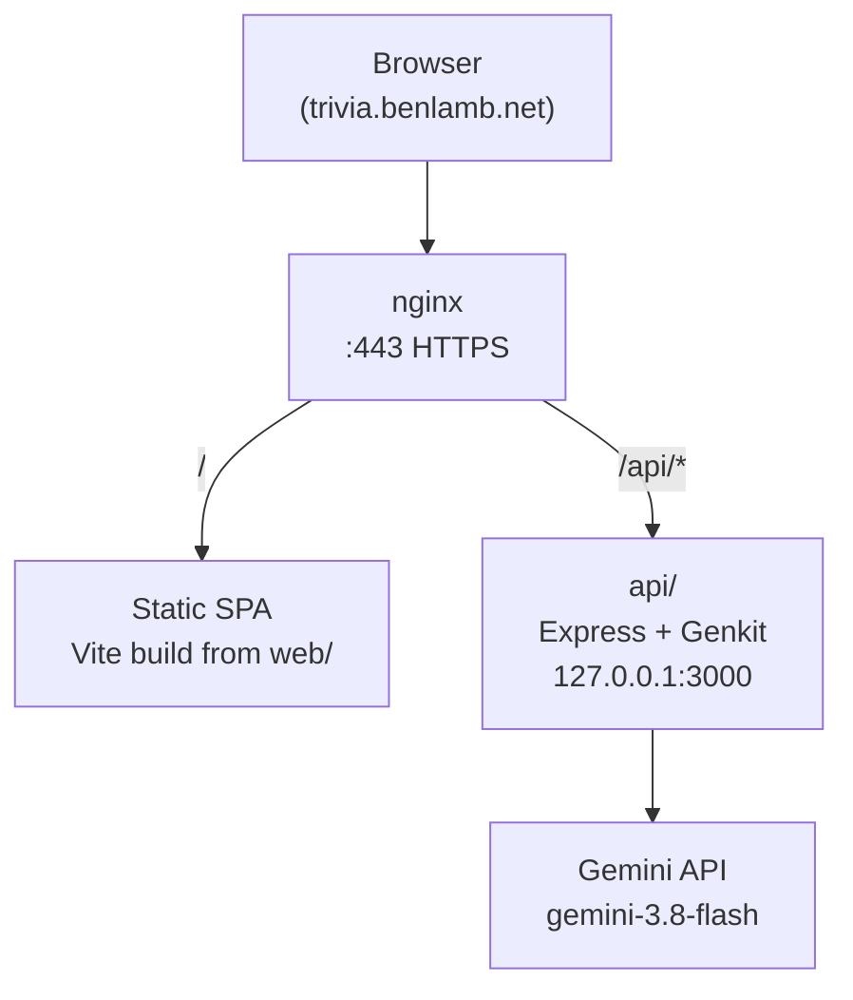
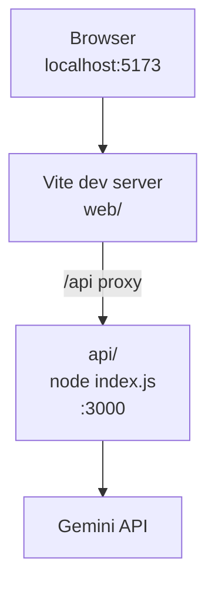
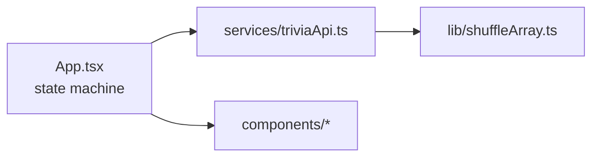
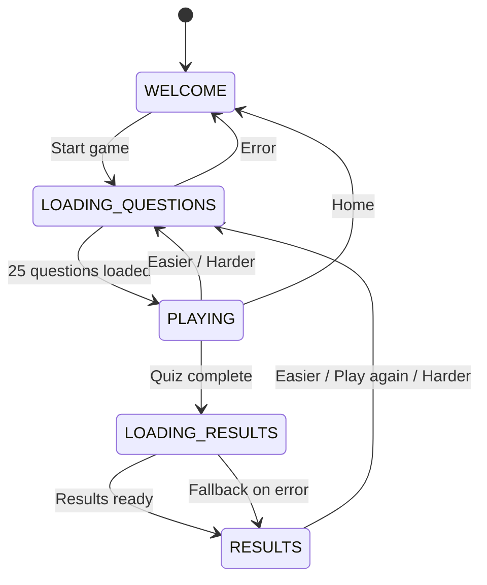
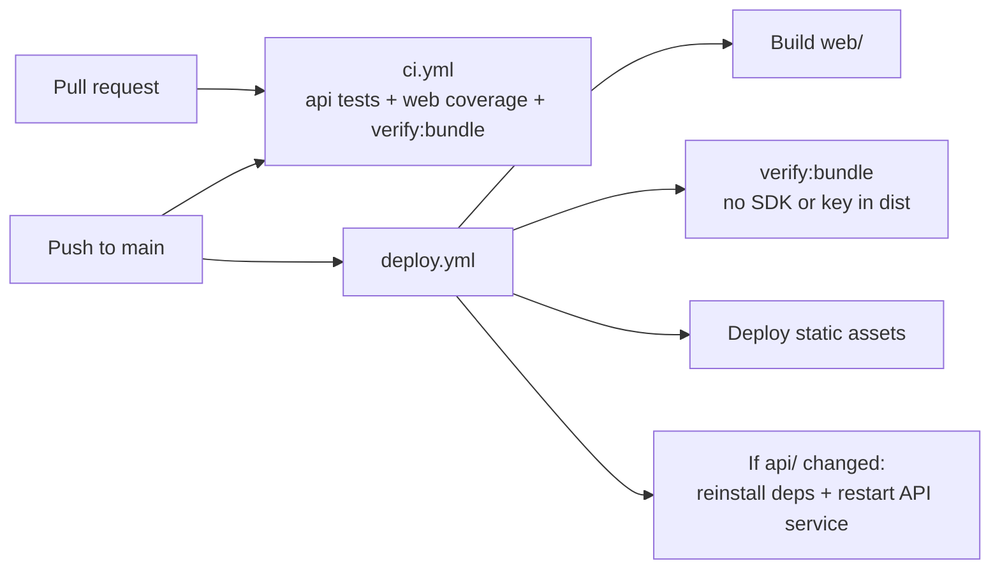

# Architecture

How the IT Trivia Challenge monorepo is wired: a React SPA, a small Genkit API proxy, and Gemini for on-the-fly questions and results. No database, no auth, no API keys in the client.

**Live:** [trivia.benlamb.net](https://trivia.benlamb.net)

## Monorepo layout

| Path | Stack | Role |
|------|-------|------|
| `web/` | React 19, Vite 8, TypeScript | SPA; calls `/api/*` only |
| `api/` | Express, Genkit, zod | Gemini proxy; secrets in `api/.env` (gitignored) |
| `offline/` | Plain HTML/CSS/JS, Node scripts | Single-file offline edition with an embedded question bank; no API, not deployed (see `offline/README.md`) |
| `.github/workflows/` | GitHub Actions | `ci.yml` on PRs and pushes to `main`; `deploy.yml` on push to `main` |
| `ops/` | systemd, nginx, bash | Server-side pieces installed by hand (not by deploy): state directory, `/stats` route, monthly report (see `ops/README.md`) |

Backend source lives in **`api/`** inside the repo. In production, a systemd unit named `trivia-api` runs `api/index.js` from the deployed clone — that name is the **service**, not a separate top-level app directory.

## Production request flow

- **nginx** serves the built frontend at `/` and proxies `/api/*` to the Node process on loopback.
- Static files are deployed artifacts (built from `web/dist/`), not edited on the server by hand.
- **`GOOGLE_GENAI_API_KEY`** exists only in `api/.env` on the host running `api/`.

## Local development

Run the API and frontend in two terminals (`api/` then `web/`). Vite proxies `/api` to port 3000 and presents the live site's `Origin`, because the API's origin check accepts no other browser origin — see `web/vite.config.ts`.

## Frontend (`web/`)

| File | Responsibility |
|------|----------------|
| `App.tsx` | Game state machine; orchestrates screens; `/stats` renders the lazy-loaded `StatsPage` |
| `services/triviaApi.ts` | `POST /api/questions`, `POST /api/results`, `GET /api/stats` |
| `lib/device.ts` | Anonymous random device ID kept in `localStorage` (usage stats only) |
| `components/StatsPage.tsx`, `StatsCharts.tsx` | Public stats dashboard at `/stats` |
| `components/PlayCounter.tsx` | "N quizzes played" line in the footer |
| `lib/shuffleArray.ts` | Shuffles options; assigns question `id` |
| `components/*` | Welcome, Quiz, Results, Loading, Error, Footer |
| `types.ts` | `GameState`, `Question`, `GameResult`, categories |
| `index.tsx` | React root mount |

### Game state machine

**Start game:** Welcome optionally adjusts starting difficulty (defaults to Easier, one notch below Normal) → `POST /api/questions` (plus previous quiz questions on replay) → add `id`, shuffle options → quiz (25 questions, 5 categories × 5 each).

**Finish game:** Tally score → `POST /api/results` with `{ score, total }` → personalized title, evaluation, motivation.

**Replay:** Results offers up to three buttons: Try an Easier Quiz (one tier down), Play Again (same tier), Try a Harder Quiz (one tier up). The step past either end of the scale is omitted, so Much Easier shows no easier button and Much Harder shows no harder button. The chosen tier becomes the current tier and the previous 25 questions are sent along so the next set avoids repeats.

**Leave mid-quiz:** The quiz header offers Home plus the same easier and harder steps, so a student isn't stuck in a quiz that doesn't fit. Switching works exactly like a replay. Home keeps the current tier on the Welcome slider, and the next Start New Game still sends the abandoned questions. Leaving cancels any pending answer reveal, so an abandoned quiz never reports a score.

## API contract

Keep **`api/index.js`** and **`web/services/triviaApi.ts`** in sync when changing shapes.

| Method | Path | Request | Response |
|--------|------|---------|----------|
| `GET` | `/api/health` | — | `{ "status": "ok", "model" }` |
| `POST` | `/api/questions` | `{ difficulty?, previousQuestions?, deviceId? }` | `{ gameId, questions: [{ category, text, options[4], correctAnswer }] × 25 }` |
| `POST` | `/api/results` | `{ score, total, gameId?, deviceId? }` | `{ title, evaluation, motivation }` |
| `GET` | `/api/stats` | — | Public anonymous usage + cost summary (any origin, cached 60 s) |
| `GET` | `/api/stats/daily.csv` | — | Daily usage and estimated Gemini cost as CSV |

Errors from `/api/questions` and `/api/results` come back as `{ "error": code }`:

| Status | Code | Meaning |
|--------|------|---------|
| 400 | `invalid_request` | Bad browser input; the only error that blames the client |
| 403 | `forbidden_origin` | Request came from another website |
| 413 | `payload_too_large` | Body over the 2 MB limit |
| 429 | `rate_limited` | Over the per-IP limit |
| 500 | `internal_error` | Anything else, including Google refusing the call (bad key, retired model) |
| 502 | `bad_model_reply` | Gemini's reply failed the schema check or was blocked, even after one retry |
| 503 | `upstream_busy` | Google is shedding load and retries ran out |

`gameId`/`deviceId` are optional so older clients keep working. Send header `X-Trivia-Test: 1` on any manual or scripted test so it is not counted as a player (it is still counted in cost).

The frontend sends full previous quiz questions on replay to help Gemini avoid exact or near-duplicate questions. It adds `id` and shuffles `options` after fetch; the API returns canonical `correctAnswer` text.

## Backend (`api/`)

Single entry point: **`api/index.js`** — Express routes plus two Genkit flows with zod structured output. The quiz prompt and its schemas live in **`api/triviaQuestions.js`**.

| Flow | Input | Output |
|------|-------|--------|
| `triviaQuestionsFlow` | `{ difficulty?, previousQuestions? }` | 25 MCQs across 5 IT categories (5 per category) |
| `triviaResultsFlow` | `{ score, total }` | Fun title, evaluation, motivation |

| Concern | Detail |
|---------|--------|
| Model | `googleai/gemini-3.8-flash` by default; override with `TRIVIA_MODEL` in `api/.env` (plugin: `@genkit-ai/google-genai`) |
| Schema checks | Rules are written in zod. Genkit converts them to JSON Schema, sends that to Gemini, and checks replies and flow input with Ajv, so zod's own `.parse` and `.default()` never run on a live request |
| Gemini failures | `generateWithRetry` retries overload with backoff inside `TRIVIA_RETRY_BUDGET_MS`, stops at once if Google refuses the call, and gives a bad reply one retry. Rejected replies were still billed, so they're logged with real tokens and cost |
| Rate limit | 30 requests/minute per client IP, shared by `/api/questions` and `/api/results` (a classroom shares one IP); override with `TRIVIA_RATE_LIMIT_PER_MIN` in `api/.env` + restart |
| CORS (prod) | Origin restricted to `https://trivia.benlamb.net` |
| Secrets | `GOOGLE_GENAI_API_KEY` in `api/.env` only — use `api/.env.example` as template |
| Usage + cost tracking | `analytics.js` appends one JSON line per event to `/var/lib/trivia-api/events.jsonl` (systemd `StateDirectory`, outside the deploy-reset checkout): quiz generated / abandoned / failed, game completed (score, difficulty), and every Gemini attempt with its tokens and estimated cost. No IPs, names or user agents. History from 2026-10-03 was imported from nginx logs (counts only). |
| Pricing | `pricing.js`: Gemini list prices with effective dates (2027-01-01 doubles 3.x Flash); each call is priced on its own date. Estimates only; Google's invoice is the receipt. |
| Reports | `scripts/report.mjs` (text, CSV, JSON, raw events per month); `ops/trivia-monthly-report` emails it on the 1st. |

## CI and deploy

- **`ci.yml`:** Node tests in `api/`, Vitest coverage in `web/`, then `npm run verify:bundle` (ensures no `@google/genai` or `AIza…` in client bundles).
- **`deploy.yml`:** SSH to VPS, `git reset --hard` to the pushed commit, build frontend, rotate nginx static root, and reinstall dependencies and restart the API systemd unit when `api/` changed.
- On `main`, CI runs beside the deploy, not before it, so a failing test doesn't stop a deploy. Run the tests before pushing.

Operator detail (paths, rollback, journalctl): [CLAUDE.md](../CLAUDE.md).

## Security checklist (safe to share publicly)

- No API keys, tokens, or `.env` contents in the repo or client bundle.
- Client only talks to same-origin `/api/*` (or Vite proxy in dev).
- Post-build check: `web/npm run verify:bundle` (also run on deploy).
- Rotate keys in `api/.env` on the server and restart the API service — never commit `.env`.

## Related docs

- [README.md](../README.md) — setup and quick architecture summary
- [CLAUDE.md](../CLAUDE.md) — deploy paths, systemd, manual ops
- [CONTRIBUTING.md](../CONTRIBUTING.md) — PR workflow
